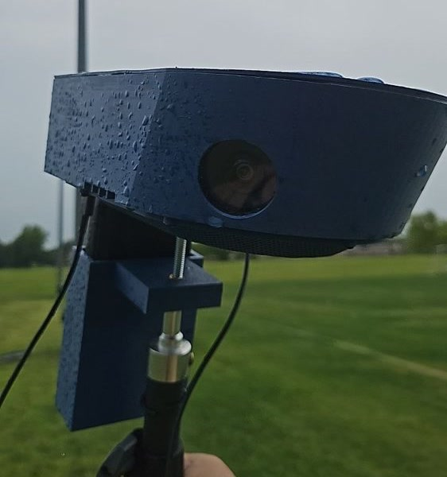

# Reco Kit

Dual-camera sports capture hardware.



A Jetson and two IMX477 cameras in a 3D-printed case. Custom drivers read 4K off each sensor; the unit stitches, tracks, and records an auto-directed 1080p view on its own, to a card and optionally to a YouTube or Twitch stream. No laptop on the sideline.

This is a reference design in progress, not a finished product, and not plug-and-play. It films full matches on our end, but expect to debug your way through a build; the path is not smooth yet, and sample footage is on the way. Calibration accuracy is the main rough edge; the case and mount work well but take real time to build. Everything is open, so it can be built on. Builds and questions go to the [forum](https://forum.reco-project.org); bug reports stay on GitHub.

*Some of these docs were drafted with LLM assistance and may contain inaccuracies. We are refining them down to the product and the knowledge we actually built over five months of research and development.*

## What works today

- Two IMX477 sensors captured at 4032x3040 / 30 fps through the custom driver.
- Real-time GPU stitch of the two views into one panorama.
- Automatic tracking that follows play and frames a 1080p output, no manual panning.
- Records to a card; optional live stream to YouTube or Twitch.
- Runs off a USB-C power bank, no laptop.
- Weather-resistant: the cooling fan's airflow stays outside the sealed case.

## What still needs work

- **Calibration accuracy** is the biggest gap. The range of lenses in use makes one calibration hard to generalize, and lenses can shift slightly over time, which drifts the seam.
- **Left/right camera assignment** is still trial-and-error, not yet automatic.
- **Build effort.** The case and mount work well, but they take real time to fabricate. A simpler, faster-to-build design is a welcome improvement.
- **No microphone / audio yet.** Video only.
- **Low light.** The IMX477 is noisy in low light, so night footage is grainier than daytime.
- Some artifacts are not in the repo yet (print settings, assembly photos, a finalized BOM). See [`STATUS.md`](STATUS.md).

## Modular

1080p is where the reference runs today, not a hard limit.

- **Compute.** Use the Orin Nano Super or an Orin NX. (The original Jetson Nano is not recommended: deprecated stack and too little GPU.) The main reason to step up to the Orin NX is the hardware encoder (NVENC) the Orin Nano lacks, which offloads the software H.264 encode from the CPU.
- **Sensor.** IMX477 is what is tested; calibration is sensor-agnostic, so a different pair is a calibration away.
- **Spare capacity.** The GPU is mostly idle and there is RAM to spare while it films, so the Jetson can run your own model or a small server alongside the capture.

| | |
|---|---|
| Compute | Jetson Orin Nano Super, or Orin NX |
| Capture | Two IMX477, 4032x3040 each at 30 fps |
| Output | Stitched, auto-tracked 1080p |
| Power | 25,000 mAh (90 Wh) USB-C bank; a full tournament in testing |
| Rough cost | About $450 to $600 in parts |

## Build

1. Print the case - [`hardware/case/`](hardware/case/) (STL parts included).
2. Flash the Jetson and bring up the OS - [`docs/jetson-setup.md`](docs/jetson-setup.md).
3. Bring up the board - `sudo provisioning/setup.sh` builds and installs the driver, sets the performance mode, and applies the 4K30 device-tree overlay in one command ([`driver/dtbo_patches/`](driver/dtbo_patches/) holds the overlay and its apply/revert scripts if you would rather run that step by hand).
4. Preview and focus the cameras - [`provisioning/preview.py`](provisioning/).
5. Calibrate the stereo rig - [`calibration/`](calibration/).
6. Run the engine - [video-stitcher](https://github.com/reco-project/video-stitcher) does the stitch, track, and record. A one-button record/stream app (gameday) is coming.

Parts list: [`hardware/bom/`](hardware/bom/). A few pieces are still landing (print settings, assembly); see [`STATUS.md`](STATUS.md).

## Community tools

Small tools that extend the Kit (a perf tuner, a remote-login helper, a plugin) live in [`community/`](community/). Anything larger belongs in its own repo. Share them on the [forum](https://forum.reco-project.org).

## Repository layout

```
hardware/       BOM, 3D-printed case, assembly + wiring          [CERN-OHL-W-2.0]
driver/         IMX477 4K30 Jetson kernel driver, isolated       [GPL-2.0-only]
provisioning/   Jetson bring-up (setup.sh) + preview             [Apache-2.0]
calibration/    stereo calibration tools + guide                 [Apache-2.0 / CC-BY-SA-4.0]
community/      community-contributed helper tools               [Apache-2.0]
docs/           setup, calibration, licensing                    [CC-BY-SA-4.0]
```

## Licenses

Multi-licensed by artifact type (see [`docs/licensing.md`](docs/licensing.md)): hardware CERN-OHL-W-2.0, driver GPL-2.0-only (derives from the kernel + NVIDIA + RidgeRun, cannot be relicensed), tooling Apache-2.0, docs CC-BY-SA-4.0.

## Credits

The hardware is [Lucian's](https://github.com/Lucian720) work. He designed the case and the rig over dozens of iterations into something that has proven robust and practical across our testing sessions, and put a lot of his own resources into making it real. Huge thanks to him, and he co-maintains this repo.

The software side is [Mohamed Taha Guelzim's](https://github.com/mohamedtahaguelzim) work: the IMX477 4K30 driver, the Argus camera bring-up that gets full-resolution capture off these sensors, the Reco engine integration, and the zero-copy NVMM capture path built for maximum performance on the Jetson.

## Contributing

See [`CONTRIBUTING.md`](CONTRIBUTING.md) and [`STATUS.md`](STATUS.md) for what is missing. Builds and questions: the [forum](https://forum.reco-project.org). Bug reports: GitHub issues.
